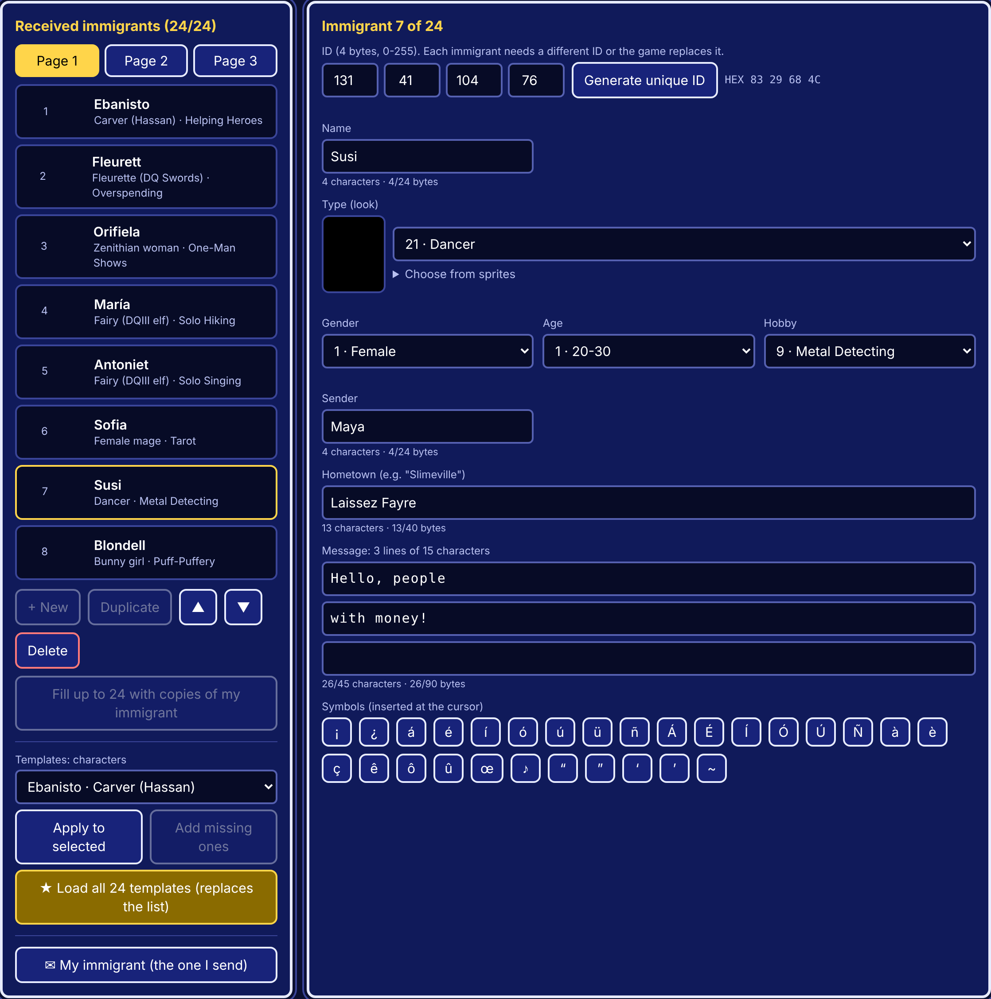
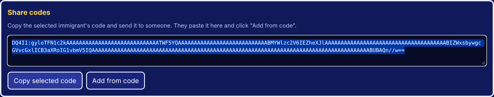

# Dragon Quest IV DS · Immigrant Editor

Offline save editor for the **Immigrant Town** of *Dragon Quest IV: Chapters of the Chosen* (Nintendo DS).
Edit the 24 immigrants of your town and the immigrant you send, without needing a second DS or a second emulator.

**Languages:** English · Español · Français
**[Español más abajo](#español)**

## Features

| | |
|---|---|
| **All 24 slots** | Edit every received immigrant (3 pages of 8) and your own immigrant. |
| **Every field** | Type (0–50, including the hidden type 50), name, gender, age, hobby, sender, hometown and message. |
| **Game-accurate messages** | 3 lines of 15 characters, padded with spaces exactly like the game stores them. |
| **Unique IDs** | Generated automatically, so the game never replaces an immigrant. |
| **Templates** | 24 ready-made characters inspired by the Dragon Quest series, loaded with one click. |
| **Share codes** | Copy an immigrant as text (`DQ4I1:…`) and paste it into another save. |
| **Safety checks** | Blocks values that freeze the game; recalculates the save checksum. |
| **Sprites from your ROM** | Character sprites are read from your own ROM. No game graphics are included. |
| **Offline** | A single HTML file. Works in any modern browser, on PC or Android. Nothing is uploaded. |

## How to use

1. Open `index.html` and choose your language (or open `editor_en.html`, `editor_es.html` or `editor_fr.html` directly).
2. **Back up your save.**
3. Load your save file: `.sav` (DeSmuME, melonDS, flashcarts), `.dsv` (DeSmuME) or `.srm` (RetroArch).
4. *(Optional)* Click **Sprites: open your ROM** and pick your *Dragon Quest IV* DS ROM to show the character sprites. They are remembered by your browser.
5. Edit your immigrants, then click **Save** and replace your save file with the downloaded one.

## Compatibility

| Version | Status |
|---|---|
| USA (En, Fr, Es) | Tested in game |
| Europe | Should work (same save format), not tested |
| Japan | Not tested |

## Share codes

Each code contains one complete immigrant. If the receiving save already has an immigrant with the same ID, the editor gives the new one a different ID automatically.

## Valid ranges

Values outside these ranges freeze the game, so the editor refuses to save them.

| Field | Range |
|---|---|
| Type | 0–50 (50 is hidden in the game's menu) |
| Gender | 0 male · 1 female · 2 "???" (monsters) |
| Age | 0–7 |
| Hobby | 0–63 |

## Technical documentation

The save format of the immigrants is documented in **[FORMAT.md](FORMAT.md)**.

## FAQ

**Is it safe?** It only changes the immigrant data and the checksum. Still, always keep a backup.

**Why do I need my ROM for the sprites?** To avoid distributing copyrighted graphics. The editor reads them from `data/G2D/ICON/sure32.mpt` in your own ROM, locally.

**Does it work on a real DS?** Yes, if you can dump and restore your save (for example with a flashcart or a save dumper).

## Credits

- **Ivan Ferrel** – research (RAM mapping, saves 0–24, in-game testing) and templates.
- Save structure cross-checked with the *Dragon Quest IV* decompilation ([DQIV-DECOMP](https://github.com/GoldieLeGenie/DQIV-DECOMP)).

## Legal

This is an unofficial fan project, not affiliated with or endorsed by Square Enix or ArtePiazza.
*Dragon Quest* is a trademark of Square Enix. This repository contains no ROMs and no game graphics.
Code released under the [MIT License](LICENSE).

---

## Español

Editor offline de los **inmigrantes** de *Dragon Quest IV: Capítulos de los Elegidos* (Nintendo DS). Edita los 24 inmigrantes de tu pueblo y tu inmigrante propio sin necesitar otra DS ni otro emulador.

**Funciones:** los 24 inmigrantes y el tuyo, todos los campos, mensajes de 3 líneas de 15 caracteres como en el juego, IDs únicos automáticos, 24 plantillas, códigos para compartir, bloqueo de valores que traban el juego, corrección del checksum y sprites sacados de tu propia ROM.

**Uso**
1. Abre `index.html` y elige **Español** (o abre `editor_es.html`).
2. **Haz copia de tu partida.**
3. Carga tu partida (`.sav`, `.dsv` o `.srm`).
4. *(Opcional)* Pulsa **Sprites: abrir tu ROM** para ver los personajes.
5. Edita, pulsa **Guardar** y reemplaza tu archivo por el descargado.

Proyecto de fans sin relación con Square Enix ni ArtePiazza. No incluye ROMs ni gráficos del juego.
